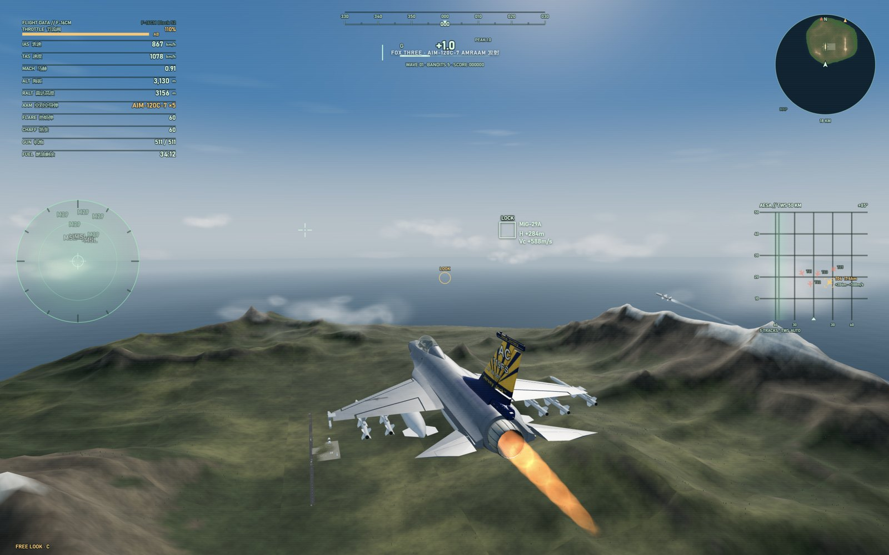
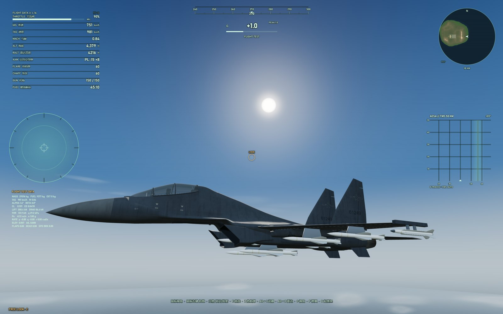
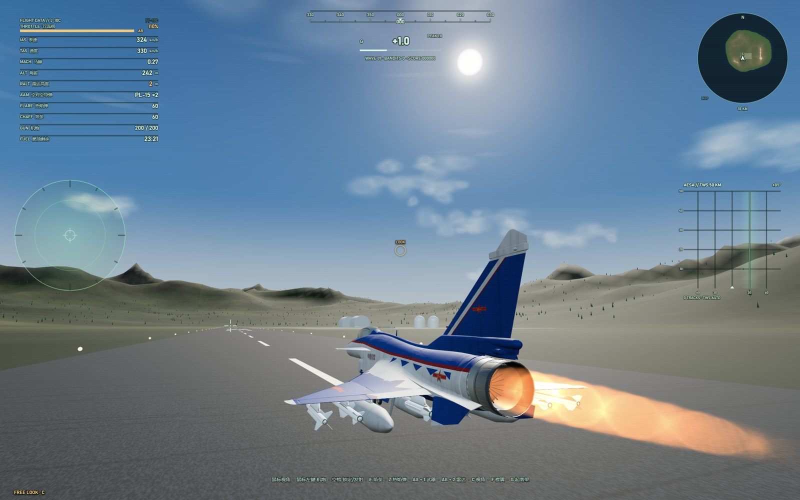

# SKYFORGE / Beyond-Visual-Range Combat

[中文](README.md) | **English**

## Special-appointed engineers

- **DeepSeek**: built the game's core framework, the test aircraft and the control system, and started early development on the F-16CM project; F-16CM development was discontinued afterwards due to limited 3D modelling capability.
- **Claude**: developed the J-10C project and refactored and unified the overall architecture, improving consistency and maintainability.
- **GPT**: took over further F-16CM development and built the J-16 project independently.

A **6-DOF jet fighter combat engine and flight testbed that runs entirely in the browser**. Flight dynamics, fly-by-wire control, weapons, AI and the procedural world are separate modules, so the game can be played directly and also used as a bench for tuning and validating aerodynamic models.



## Aircraft

Pick an airframe in the hangar, then a mission mode. All three share one flight model, one fly-by-wire system and one avionics suite; everything that differs lives in the configs under `src/data/`.

| Aircraft | Notes |
|---|---|
| **F-16CM Block 52** (default) | SolidWorks CAD airframe, hydraulic landing gear, 10 stations, 370 / 300 gal drop tanks. Wiki reference is the War Thunder F-16C Block 50; see `assets/models/f16/README.md` |
| **J-16** | Twin-seat, twin-engine, 10 stations, War Thunder wiki data and local recordings; see `docs/J16_GAME_INTEGRATION.md` (the wiki lists no drop tanks, so none are offered) |
| **J-10C** | Single-engine canard delta, 11 stations, 1600 L / 800 L drop tanks, base livery and the August 1st scheme; see `assets/models/j10c/README.md` |

Shared mechanisms, per-aircraft values: ceilings and takeoff-flap limits come from each aircraft's wiki page, the afterburner threshold is unified (afterburner only after full military thrust), ground pitch limits are the measured tail-strike angles (F-16CM 10° / J-16 9.5° / J-10C 12°), cannon belts switch with `K` on all three, and drop-tank fuel is burned before internal fuel.

Development rules (ownership, write rules, review of new concepts) are in [docs/REPO_CONTRACT.md](docs/REPO_CONTRACT.md) — written in Chinese, and authoritative for anyone contributing.

## Screenshots

| | |
|---|---|
|  |  |

## Quick start

**Windows: double-click `SKYFORGE.vbs`.** It hides the console, starts a local server and opens the game in Chrome/Edge in **app mode, fullscreen** (no address bar, no tab strip, no window frame). `start.cmd` does the same with a visible console.

Manually:

```bash
node server.mjs 4173
# then open http://127.0.0.1:4173/
```

A static server also works:

```bash
python -m http.server 4173 --bind 127.0.0.1
```

> The page must be served over local HTTP — opening `index.html` directly is blocked by the browser's ES module / CORS rules. There is no build step and no network access at runtime.

Chrome or Edge recommended (WebGL2). If the GPU is struggling, switch "Settings → Graphics" to "Performance".

## Controls

Every one of the 33 actions can be rebound under **Settings → Key bindings**: click "Modify", press a single key or a chord, then click "Confirm" with the mouse to save. Several actions may share a binding; a complete chord wins over its single keys. Defaults:

| Input | Action |
|---|---|
| Mouse move | **FPS-style mouse look**: the mouse turns the camera directly, the nose follows the view centre under fly-by-wire limits |
| `W` / `S` | Push nose down / pull nose up (up to the full positive/negative load limit) |
| `A` / `D` | Roll left / right, continuous 360° (steering on the ground) |
| `Q` / `Y` | Rudder left / right |
| `Shift` / `Ctrl` | Increase / decrease throttle |
| Mouse wheel | Throttle trim |
| `G` | Landing gear |
| `F` / `Alt+F` | Flaps / takeoff flaps |
| `H` | Airbrake / wheel brakes |
| `P` | Canopy |
| `B` / `J` | J-16, J-10C: drag chute / fuel dump |
| `O` | Jettison all drop tanks |
| Left mouse | Cannon (F-16 20 mm M61A1 / J-16 30 mm / J-10C 23 mm) |
| `Space` | Lock / fire / drop: first press acquires a target, second press fires once the ring closes; bombs go to the line-of-sight impact point |
| `Alt+1` / `Alt+2` | Cycle weapon / radar range |
| `K` | Cycle cannon belt |
| `R` or mouse side button 4 | Cycle locked target |
| `Z` / `E` | Flares / chaff |
| `X` / `C` | Cockpit / chase view · free-look toggle |
| `V` / `T` / `M` | Pitch ladder · telemetry · tactical map |
| `L` | Release / recapture the mouse cursor |
| `N` | Mute toggle |
| `Esc` / `F1` | Pause / help |

The two-stage `Space` design prevents accidental launches: `SPACE LOCK` first, then the HUD shows `SEEKER LOCKED / SPACE FIRE` once the ring closes.

### Mouse aiming

The circle in the centre of the screen is the **mouse cursor** — moving the mouse turns the camera, FPS style. The crosshair is the **nose direction** and drifts away from the circle, then automatically turns back toward the view centre. `MouseAim.updateToward()` treats the camera direction as the nose target: it banks, coordinates the turn and pulls load based on heading/pitch error, then the existing fly-by-wire and AoA/G limits execute it. The view moves instantly, the nose follows under physical limits; the camera no longer follows the nose, so looking back does not drag the view around. There is no "rubber band" between cursor and crosshair.

Full error commands roughly **8.6 G / 83° of bank**, a sustained turn near **20 s per circle** at F-16A level; peak roll rate is about **280°/s**. `W`/`S` bypass rate scaling and request the fly-by-wire's available load limits directly. Free look (`C`, on by default) disables nose-follows-view: the mouse still turns the camera and the keyboard still flies the aircraft.

`A`/`D` bypass the mouse autopilot's bank limit and are a raw roll axis, so 360° rolls and inverted flight are possible; pressing them temporarily yields roll control from the autopilot and returns it on release.

## Game modes

1. **Instant combat** — start airborne, hostiles arrive in waves, score by kills; respawn after death.
2. **Runway takeoff** — start static on the runway with takeoff flaps preselected. Hold left `Shift` for throttle, press `S` around 280 km/h (liftoff near 330 km/h; hands-off at full afterburner lifts off after 800–850 m at 400–450 km/h), then `G` to raise gear. Gear speed limits differ per aircraft; overspeeding with gear down damages them.
3. **Performance test flight** — free flight at altitude with `T` for live aerodynamic and engine telemetry.

## What is implemented

- **F-16 data baseline**: F-16A Block 10 aerodynamics and propulsion (F100-PW-220, ~105.7 kN afterburning thrust, 27.87 m² wing, 9 G limit, 511 rounds of M61A1). The F-16CM uses that baseline with a CAD airframe.
- **6-DOF rigid-body aerodynamics**: ISA atmosphere, lift/drag/side force, induced drag, Mach drag rise, stall, ground effect, control-surface effectiveness and damping, engine spool lag, fuel mass change.
- **Fly-by-wire**: G and roll-rate commands, AoA/G limiting, actuator rate limits, control-surface inversion — not "key press rotates the aircraft".
- **Fighter systems**: gear, flaps, airbrake, wheel brakes, tyre friction, runway takeoff/touchdown detection, fuel. The player aircraft has no automatic over-G or overspeed damage; only combat damage, ground impact and fuel exhaustion stop the engine.
- **Weapons and countermeasures**: IR and radar-guided missiles (decoyable by flares and chaff), unguided and guided bombs, cannon lead computation, impacts, explosions, smoke trails, flares, launch warnings. Cannon belts compute damage, tracers and penetration per shell type; all three aircraft switch with `K`.
- **Drop tanks**: F-16CM (370 / 300 gal, 3,090 kg of fuel) and J-10C (1600 / 800 L, 3,320 kg) take their tank fuel from the wiki. Tanks feed first, aircraft mass drops as they empty, an empty tank drags the same as a full one; `O` jettisons, respawn refills. HUD endurance includes tank fuel and `T` telemetry shows `EXT`. J-10C tank dimensions are estimated from capacity.
- **AI and missions**: MiG-29 training targets in waves of five; they **do not attack** and never fire, only orbit widely near their spawn points, appearing 16–32 km around the player. They still avoid terrain, turn at the boundary and fly the full flight model, and can be shot down normally.
- **Procedural world**: 60 km × 60 km island terrain, forests, ocean, clouds, runway/taxiway/hangars/tower/fuel tanks, procedural F-16 and MiG-29 shapes, animated gear/flaps/airbrake/afterburner.
- **Airframe detail**: intake cowl and lip share one superellipse section, dark intake duct and compressor face; segmented convergent nozzle, turbine face and afterburner ring; gear lowers correctly on the ground and folds into the fuselage when retracted.
- **Cockpit**: elliptical opening flush with a matching rim, instrument panel, analogue dials, centre MFD, side consoles/throttle/rudder pedals, HUD frame, simplified stick-figure pilot; `P` toggles the transparent canopy.
- **Avionics / situational awareness**: F-16A style **AN/ALR-69** RWR (360°, emitter identification, search/track, no ranging; IR launches produce no RWR warning), **50 km** default range (`Alt+2` cycles 50/25/10/100 km), ±85° TWS B-scope, scan line, target altitude difference and closure rate, circular north-up minimap, threat bearings; `M` opens a borderless **60 km × 60 km tactical map**.
- **HUD**: no boxes, fully transparent background (text, hairlines, brackets); left data stack ordered throttle, IAS, TAS, Mach, altitude, radar altitude, AAM, flares, chaff, cannon, fuel time; semi-transparent green RWR disc at mid-left; system status bar; G at top centre; minimap top right; borderless TWS; kill feed bottom right.
- **Hangar and loadouts**: a separate hangar screen with the sortie type on top and the aircraft row at the bottom; a "loadout / collapse" toggle groups stores by category; all three aircraft have liveries (F-16CM base / Jersey Jerk, J-16 base / grey camo, J-10C base / August 1st) applied live. Presets persist per aircraft; the F-16CM default air-superiority fit is **4 × AIM-120C + 2 × AIM-9M**. Left-drag orbits, wheel zooms; every store the aircraft can carry is displayed on the hangar floor. Missiles, bombs and guided bombs are all wired into the combat system; loadout-capable aircraft are registered in `LOADOUT_JETS` in `src/data/hangar.js`.
- **Full front end**: Chinese menu, persistent settings, help, pause, death, restart, fullscreen; box-free menu cards, buttons and dialogs (text, underlines and a left colour bar only).
- **Audio**: each aircraft has its own local pack (`audio/pack.json`, `audio/j16/pack.json`, `audio/j10c/pack.json`). Engine, afterburner, cockpit and cannon samples were decoded from a local War Thunder installation (sources and hashes in each directory's `sources.json` and `audio/local-sources.json`); wind and some mechanical sounds are still WebAudio synthesis. The War Thunder install is never modified and only the few samples actually used are extracted.
- **Performance**: hostiles, stores, trails and particle materials are warmed up at load; the five MiGs and trails are pooled and hidden/reused rather than destroyed on a kill; afterburner lights are emissive geometry instead of adding and removing point lights, avoiding a full-scene shader recompile at the moment of a radar acquisition or kill. First hostile visible frame measured from ~430 ms to ~4 ms; kill handling ~1–2 ms (software rendering).

RWR/TWS reference capabilities and their simplifications are covered in [docs/AVIONICS.md](docs/AVIONICS.md).

## Repository layout

```text
skyforge/
  index.html / styles.css       shell and UI styling
  server.mjs                    zero-dependency static server
  src/
    core/                       Game.js orchestration, input, render engine
    sim/                        atmosphere, aerodynamics, flight model, aircraft, AI, combat
    visual/                     jets, CAD geometry, effects, skinning, model cache
    world/                      terrain, ocean, sky, clouds, minimap
    ui/                         HUD (canvas) and DOM screens
    data/                       aircraft registry and weapon/loadout tables
  assets/models/                per-aircraft GLB files and notes
  sources/                      collected snapshots (wiki pages, J-10C CAD faces, audio inventory)
  audio/                        per-aircraft sound packs with provenance
  tests/                        pure Node tests (*.test.mjs)
  tools/                        build scripts, preview pages, browser checks
  docs/                         feature docs and the repository contract
  vendor/                       Three.js r128 (MIT)
```

Flight simulation never touches the DOM, `visual/` only consumes simulation state and `Game.js` orchestrates; every aircraft difference lives in `src/data/` configs, so adding an aircraft does not touch the flight model or the HUD.

## Tests

There is no npm setup — run Node directly (`package.json` scripts are just an index):

```bash
node tests/flight.test.mjs
```

Pure Node tests live in `tests/` (flight, takeoff trim, landing tolerance, controls, AI, audio, plus per-aircraft model and integration tests). Browser checks live in `tools/check-*.mjs` and need `node server.mjs 4173` running first. Which checks each area requires is listed in `docs/REPO_CONTRACT.md` §7.

## Contributing

- Read [docs/REPO_CONTRACT.md](docs/REPO_CONTRACT.md) first: architecture invariants, the concept registry and per-directory write permissions. Shared code must not branch on aircraft id; per-aircraft differences go into config fields or registry entries.
- The repository uses git (`main`). Only commit the paths you changed (`git add <path>`, never `git add -A`), do not switch branches or rewrite history, and let the maintainer push.
- A new config field, registry, directory, storage key or key binding is a "new concept": propose it first, then register it in the contract.
- Data needs provenance: wiki data goes into page snapshots under `sources/wiki/` and is turned into `src/data/*Wiki.js` by `tools/import-*-wiki.py`; authored coefficients are explained in comments or `estimates`.
- Update this README whenever a player-visible feature, control or layout changes.

## Known limitations

- A single-player technical demo: no multiplayer, no campaign, no realistic avionics.
- Damage is a simplified zone/probability model — no hydraulics, fires or jammed surfaces.
- IR guidance, radar and electronic warfare are game approximations; the AI does not use real tactical databases.
- The RWR only models ALR-69 bearing, emitter type and search/track state — no real PRF, bands or full threat library. IR launches give no RWR warning, only visual/game cues.
- TWS ignores ground clutter, head-on/tail-on cross sections, terrain masking and ECM; targets within ±85° up to the current range are shown with simplified detection.
- The AI is a **non-attacking training target** and never fires guns or missiles; chaff is modelled in the HUD and loadout data but there is no radar-guided threat to decoy.
- The War Thunder FMOD banks are Gaijin Entertainment's game assets: this project never modifies the game directory and never copies whole banks, only the few samples actually used, with sources and hashes recorded in `audio/*/sources.json`. This is a free, non-commercial fan-made technical demo, not sold or distributed for payment.
- Terrain collision only uses terrain height, runway and airbase boundaries — no per-building collision.
- Not an official Gaijin product; no War Thunder code is included.

## Credits

- [War Thunder Wiki — F-16A Block 10](https://wiki.warthunder.com/unit/f_16a_block_10): baseline for the F-16 flight model.
- War Thunder Wiki — [F-16C Block 50](https://wiki.warthunder.com/unit/f_16c_block_50), [J-16](https://wiki.warthunder.com/unit/j_16), [J-10C](https://wiki.warthunder.com/unit/j_10c): ceilings, flap limits, cannon belts, stations and drop tanks (page snapshots in `sources/wiki/`).
- Public F-16 / F100-PW-220 material used to cross-check thrust and weight class.
- Rendering: Three.js r128, MIT License, see `vendor/LICENSE-three.txt`.
- Terrain, aircraft shapes, textures, UI and audio are generated by this project.

## License

Code is released under the MIT License, see [LICENSE](LICENSE). Three.js keeps its original MIT license.
